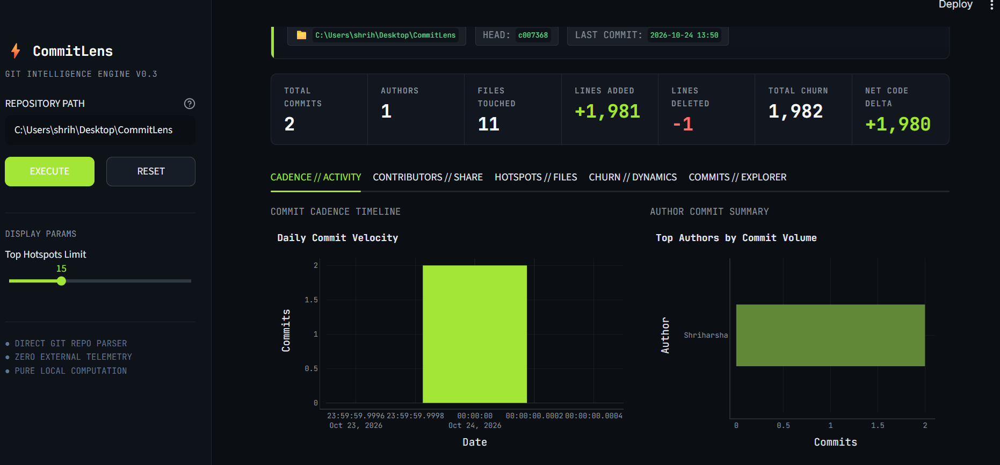

# CommitLens

**Git Repository Intelligence & Code Churn Analyzer**

[](https://www.python.org/)
[](https://streamlit.io/)
[](https://plotly.com/)
[](tests/)

CommitLens is a developer telemetry and Git repository intelligence tool that transforms raw commit history into actionable codebase insights. Built with a modular Python architecture and a dark, developer-focused Streamlit interface, CommitLens provides software engineers and engineering leads with visibility into commit cadence, contributor distribution, file modification hotspots, and line churn dynamics.

---

## The Problem CommitLens Solves

Version control history is one of the most underutilized assets in software engineering. While tools like `git log` and `git diff` provide granular command-line outputs, they make it difficult to answer high-level engineering questions:

- **Where is technical debt accumulating?** Files that are touched repeatedly across commits (hotspots) often indicate high coupling, architectural friction, or defect-prone modules.
- **How is code churn evolving?** High churn (rapid additions and deletions) can highlight active refactoring or unstable requirements that need attention.
- **How is work distributed across the team?** Understanding contributor commit volume and code modification balance helps spot bottlenecks and knowledge silos.

CommitLens analyzes local Git repositories directly—without third-party telemetry, cloud uploads, or external API keys—delivering instant, offline codebase intelligence.

---

## Key Features

- **Direct Git History Scanning**: Extracts complete commit metadata (40-character SHA hash, author identity, ISO 8601 timestamps, commit messages) directly from the local repository HEAD.
- **Contributor Analytics**: Aggregates commit volume per contributor, computes relative share percentages, and tracks lines added versus deleted per author.
- **File Hotspot Detection**: Measures commit touch frequency per file using Git rename detection (`-M`), identifying frequently modified files.
- **Interactive Hotspot Views**: Toggle between an interactive **Treemap Footprint** (`px.treemap`) and **Ranked Hotspot Bars**, with an interactive file inspector to query exact commit touch counts and modification frequencies.
- **Line Churn Dynamics**: Tracks per-commit insertions and deletions using `git diff-tree` statistics, computing total code churn (`insertions + deletions`) and net code delta.
- **Diverging & Scatter Visualizations**: Visualizes additions (+) and deletions (-) per commit through diverging bar charts and commit impact magnitude scatter plots.
- **Searchable Commit Explorer**: Filter commit logs by author, search by keyword or hash, inspect detailed commit diff stats, and export filtered logs to CSV.
- **Robust Error & Edge Case Handling**: Explicit handling for non-existent filesystem paths (`FileNotFoundError`), non-Git directories (`ValueError`), empty repositories with zero commits, and single-commit sparse repositories.
- **Clean Number Formatting**: Formats signed line changes consistently (`+N`, `-N`), strictly preventing negative zeros (`0`, never `-0`).

---

## Dashboard Preview




## Architecture & Code Organization

CommitLens follows a strict separation of concerns across three distinct layers:

```
CommitLens/
├── commitlens/
│   ├── __init__.py
│   ├── scanner.py          # Data ingestion layer: raw Git commit extraction
│   └── analytics.py        # Business logic: pure metrics & diff calculations
├── tests/
│   ├── test_scanner.py     # 9 tests: path validation, commit fields, empty repos
│   └── test_analytics.py   # 22 tests: churn, authors, renames, deletions, binaries
├── .streamlit/
│   └── config.toml         # Streamlit dark theme configuration
├── app.py                  # Presentation layer: Streamlit dashboard & Plotly HUD
├── requirements.txt        # Project dependencies
└── README.md
```

### Module Responsibilities

1. **`commitlens/scanner.py` (Data Extraction)**
   - Responsible solely for validating filesystem paths and extracting raw commit history from local Git repositories using GitPython.
   - Provides `scan_repo(path)` which returns a structured list of commit dictionaries (`hash`, `author`, `date`, `message`).
   - Does not perform any metric calculations or UI rendering.

2. **`commitlens/analytics.py` (Metric Computation)**
   - Contains pure calculation functions and Git diff analysis routines independent of the scanner and dashboard.
   - **Pure functions**: `total_commits()`, `commits_by_author()`, and `code_churn()`.
   - **Diff-analyzing functions**: `file_change_frequency()` (tracks modified, added, deleted, renamed, and binary files) and `lines_changed()` (per-commit additions and deletions, handling root commits and binary diff exclusions).

3. **`app.py` (UI & Visualization)**
   - The presentation layer built with Streamlit and Plotly.
   - Orchestrates `scan_repo()` and analytics functions, normalizes data into Pandas DataFrames, and renders responsive dark-themed charts.
   - Encapsulates UI state management, parameter controls, search filtering, and error handling.

---

## Technologies Used

| Technology | Purpose |
| :--- | :--- |
| **Python 3.10+** | Core programming language |
| **GitPython** | Programmatic interface to local Git repository objects and diff trees |
| **Streamlit** | Interactive developer dashboard and reactive UI components |
| **Pandas** | Tabular data manipulation, grouping, and CSV export serialization |
| **Plotly Express / Graph Objects** | Interactive charts (treemaps, diverging bar charts, scatter plots) |
| **pytest** | Automated test suite with isolated temporary Git test repositories |

---

## Installation & Setup (Windows PowerShell)

Follow these steps to set up and run CommitLens locally using Windows PowerShell:

### 1. Clone the Repository

```powershell
git clone https://github.com/shriharsha077/CommitLens.git
cd CommitLens
```

### 2. Create and Activate a Virtual Environment

```powershell
# Create virtual environment named .venv
python -m venv .venv

# Activate the virtual environment
.\.venv\Scripts\Activate.ps1
```

> *Note: If PowerShell displays an execution policy restriction when activating, run `Set-ExecutionPolicy -ExecutionPolicy RemoteSigned -Scope CurrentUser` first.*

### 3. Install Dependencies

```powershell
python -m pip install --upgrade pip
pip install -r requirements.txt
```

---

## Running the Dashboard

Launch the Streamlit dashboard using the virtual environment:

```powershell
streamlit run app.py
```

Or using the explicit virtual environment executable:

```powershell
.\.venv\Scripts\streamlit.exe run app.py
```

Once started, the dashboard will open automatically in your default browser at:
```
http://localhost:8501
```

### Using the Interface
1. Enter the absolute path or relative path (e.g., `.`) of any local Git repository in the sidebar.
2. Click **EXECUTE** to trigger repository analysis.
3. Switch between the five analysis tabs to inspect cadence, contributors, hotspots, churn, and commit history.

---

## Running the Test Suite

CommitLens includes comprehensive automated tests that verify scanner extraction and analytics metrics against dynamically created temporary Git repositories (testing root commits, modifications, file deletions, renames via `git mv`, and binary files).

To run the complete test suite:

```powershell
.\.venv\Scripts\python.exe -m pytest tests/ -v
```

### Test Suite Summary
- **`tests/test_scanner.py`**: 9 tests covering path validation, commit field structures, chronological sorting, and empty repositories.
- **`tests/test_analytics.py`**: 22 tests covering commit counts, author tallies, rename detection, deleted file counting, binary file exclusion, root commit line addition handling, and code churn math.
- **Total**: 31 tests passing.

---

## Current Limitations & Future Improvements

### Current Limitations
- **Local Repositories Only**: CommitLens analyzes local clones on disk; it does not clone directly from remote URLs.
- **HEAD Branch Focus**: Analytics iterate from the active `HEAD` commit; multi-branch comparison or merged pull request tracking is not currently evaluated.
- **Single-Threaded Commit Diffing**: For very large repositories with tens of thousands of commits, diff parsing runs synchronously.

### Planned Enhancements
- [ ] Add branch selection and cross-branch comparison metrics.
- [ ] Introduce sliding time-window filters (e.g., last 30, 90, or 180 days).
- [ ] Implement asynchronous or cached diff computation for large monorepos.
- [ ] Add automated screenshot generation and exportable executive PDF summaries.

---

## License

This project is licensed under the [MIT License](LICENSE).
